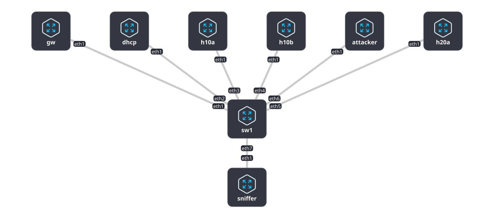

# Network Traffic Analyzer & Anomaly Detection

Công cụ Python phân tích gói tin (pcap hoặc bắt trực tiếp) trong lab Containerlab: thống kê lưu lượng theo
VLAN / giao thức / host, đo RTT bắt tay TCP và tỷ lệ retransmission, và phát hiện 5 loại bất thường tầng 2-3-4.

| Bất thường          | Cách phát hiện                                                                                                             |
| ------------------- | -------------------------------------------------------------------------------------------------------------------------- |
| Port scan           | 1 nguồn gửi SYN tới ≥ N cổng khác nhau của cùng 1 đích trong cửa sổ trượt T giây (bản nhanh + bản chậm cho `nmap -T1/-T2`) |
| ARP spoofing        | 1 IP bị gán cho ≥ 2 MAC (bỏ qua ARP probe `0.0.0.0`, whitelist VRRP/HSRP)                                                  |
| Rogue DHCP          | nguồn trả Offer/Ack/Nak không nằm trong `allowed_servers` (hoặc >1 nguồn nếu chưa cấu hình allowlist)                      |
| Broadcast storm     | số frame `ff:ff:ff:ff:ff:ff` mỗi giây vượt `max_pps`, gộp các giây liên tiếp thành 1 sự kiện                               |
| Liên VLAN trái phép | cặp (VLAN nguồn → VLAN đích) nằm trong `vlan_deny_flows` (VLAN suy ra từ subnet)                                           |

## Sơ đồ lab



## Cài đặt và chạy nhanh (không cần lab)

```bash
make install && source .venv/bin/activate
make synth          # sinh pcap tổng hợp xác định
make test           # 33 test
make eval           # bảng TP/FN/FP
python -m netanalyzer.cli analyze pcaps/synthetic/mixed.pcap --report reports/r.html --db traffic.db
python -m netanalyzer.cli live --offline pcaps/synthetic/mixed.pcap     # replay như real-time
```

## Chạy với lab Containerlab

```bash
make lab-build lab-up lab-setup     # image, deploy, cấu hình VLAN/IP/DHCP/mirror
make lab-pcaps                      # bắt pcap 6 kịch bản + biến thể vào pcaps/lab/
make eval                           # đo độ chính xác trên pcap thật của lab
sudo .venv/bin/python -m netanalyzer.cli live --iface eth1   # (trong netns của sniffer) real-time
```

Real-time trực tiếp trên sniffer container: `docker cp` thư mục project vào container (hoặc mount), cài
`python3-scapy python3-pandas python3-yaml python3-plotly`, rồi chạy `live --iface eth1`.

## Chạy tay từng kịch bản

```bash
bash lab/run_scenario.sh portscan                     # -> pcaps/lab/portscan.pcap
NMAP_TIMING=-T2 PORTS=1-100 bash lab/run_scenario.sh portscan portscan_T2
python -m netanalyzer.cli analyze pcaps/lab/portscan.pcap --report reports/portscan.html
```

## Kết quả

Bộ pcap tổng hợp (`pcaps/synthetic`, sinh xác định bởi `netanalyzer/synth.py`):

| pcap       | kỳ vọng         | phát hiện       |     |
| ---------- | --------------- | --------------- | --- |
| clean      | (sạch)          | (không)         | ✅  |
| portscan   | port_scan       | port_scan       | ✅  |
| arpspoof   | arp_spoof       | arp_spoof       | ✅  |
| rogue_dhcp | rogue_dhcp      | rogue_dhcp      | ✅  |
| bcast      | broadcast_storm | broadcast_storm | ✅  |
| vlan_viol  | vlan_violation  | vlan_violation  | ✅  |
| mixed      | cả 5 loại       | cả 5 loại       | ✅  |

7/7 pcap đúng, TP=10, FN=0, FP=0.

| pcap                      | kỳ vọng                                                           | phát hiện                                                         | kết quả |
| ------------------------- | ----------------------------------------------------------------- | ----------------------------------------------------------------- | ------- |
| lab/arpspoof.pcap         | arp_spoof                                                         | arp_spoof                                                         | ✅      |
| lab/bcast.pcap            | broadcast_storm                                                   | broadcast_storm                                                   | ✅      |
| lab/clean.pcap            | (sạch)                                                            | (không)                                                           | ✅      |
| lab/clean2.pcap           | (sạch)                                                            | (không)                                                           | ✅      |
| lab/portscan.pcap         | port_scan                                                         | port_scan                                                         | ✅      |
| lab/portscan_T3.pcap      | port_scan                                                         | port_scan                                                         | ✅      |
| lab/portscan_T5.pcap      | port_scan                                                         | port_scan                                                         | ✅      |
| lab/rogue_dhcp.pcap       | rogue_dhcp                                                        | rogue_dhcp                                                        | ✅      |
| lab/vlan_viol.pcap        | vlan_violation                                                    | vlan_violation                                                    | ✅      |
| synthetic/arpspoof.pcap   | arp_spoof                                                         | arp_spoof                                                         | ✅      |
| synthetic/bcast.pcap      | broadcast_storm                                                   | broadcast_storm                                                   | ✅      |
| synthetic/clean.pcap      | (sạch)                                                            | (không)                                                           | ✅      |
| synthetic/mixed.pcap      | arp_spoof, broadcast_storm, port_scan, rogue_dhcp, vlan_violation | arp_spoof, broadcast_storm, port_scan, rogue_dhcp, vlan_violation | ✅      |
| synthetic/portscan.pcap   | port_scan                                                         | port_scan                                                         | ✅      |
| synthetic/rogue_dhcp.pcap | rogue_dhcp                                                        | rogue_dhcp                                                        | ✅      |
| synthetic/vlan_viol.pcap  | vlan_violation                                                    | vlan_violation                                                    | ✅      |

**16/16 pcap đúng hoàn toàn** · TP=17 FN=0 FP=0 · precision=100.00% recall=100.00%

### Hiệu năng parse (đo bằng `make bench PCAP=...`)

Số đo trong môi trường phát triển (302.000 gói): scapy ≈ 5.700 gói/s, engine `fast` (struct) ≈ 159.000 gói/s
(~28×). Detector chạy 0,26 s trên cùng tập. **Hãy đo lại trên máy bạn và ghi số của bạn.**

### Đối chiếu tshark / Zeek (`make compare`)

Trên pcap tổng hợp, số gói / SYN / ARP / DHCP / RTT TB khớp tshark tuyệt đối. Sai lệch duy nhất: retransmission
trên `vlan_viol.pcap` (ta 0, tshark 2). Nguyên nhân: gói định tuyến qua gateway xuất hiện 2 lần trên trunk
(trước và sau gateway) với cùng 5-tuple/seq; tshark coi bản thứ hai là retransmission, còn công cụ này so thêm
`src_mac` nên không đếm. Với Zeek: `python tools/compare_tools.py pcaps/lab/portscan.pcap --zeek`.

## Quyết định thiết kế

- **Mirror chỉ chiều ingress** của cổng switch: mỗi frame vào switch đúng 1 lần, tránh nhân đôi gói làm sai
  retransmission/thống kê.
- **VLAN**: cổng access không còn tag 802.1Q sau mirror, nên `vlan_eff` = tag nếu có, nếu không suy ra từ subnet
  của IP nguồn. Bắt thêm ở cổng trunk (`sw1:eth1`) nếu muốn thấy tag thật.
- **Live**: cửa sổ trượt ngắn cho scan/broadcast/VLAN; trạng thái dài (10 phút) cho ARP binding và DHCP server vì
  gói giả và gói thật có thể cách nhau lâu. Đồng hồ theo timestamp gói, tick bù cả khoảng im lặng; khử trùng cảnh báo 60 s.
- **Hai parser** cùng schema; test `test_parser_equivalence.py` buộc chúng cho kết quả giống nhau.

## Hạn chế đã biết

- Scan rất chậm (> cửa sổ `portscan_slow`), scan phân tán nhiều nguồn, scan ngang (1 cổng nhiều host), scan FIN/NULL/Xmas: chưa bắt.
- ARP spoof: chủ động ngoại lệ cho VRRP/HSRP qua `ignore_mac_prefixes`; host đổi NIC hợp lệ vẫn có thể gây báo động giả (dùng `ignore_ips`).
- `vlan_deny_flows` xét theo hướng gói, không theo trạng thái kết nối: nếu cấm 20→10 thì phản hồi của host VLAN 20 cho kết nối do VLAN 10 khởi tạo cũng bị tính. Cần chuyển sang theo dõi hướng khởi tạo nếu dùng chính sách hai chiều.
- Chưa phân tích IPv6 sâu (chỉ ghi nhận địa chỉ); engine `fast` chỉ đọc pcap Ethernet (pcapng tự chuyển sang scapy).
- Chế độ live chưa chạy `portscan_slow` (cần cửa sổ dài).

## Troubleshooting

- Sniffer không thấy gói: `sudo modprobe cls_u32 act_mirred sch_ingress` trên host rồi chạy lại `lab/setup.sh`.
- `containerlab deploy` lỗi quyền: dùng `sudo`. `docker exec ... Permission denied`: đăng xuất/đăng nhập sau `usermod -aG docker`.
- hping3 không gửi được broadcast: `METHOD=scapy bash lab/run_scenario.sh bcast`.
- rogue_dhcp không thấy Offer thứ hai: kiểm tra `docker exec clab-nta-attacker pgrep dnsmasq`.

## Cấu trúc

```
netanalyzer/   parser.py (scapy + fast) · stats.py · detectors.py · report.py · live.py · alert.py
               synth.py · evaluate.py · policy.py · cli.py
lab/           Dockerfile · topology.clab.yml · setup.sh · run_scenario.sh · run_all.sh · attacks/*.sh
tests/         ground_truth.yml · test_detectors/parser_equivalence/stats/live
tools/         compare_tools.py (tshark/Zeek)
policy.yml     VLAN, DHCP hợp lệ, ngưỡng
```
